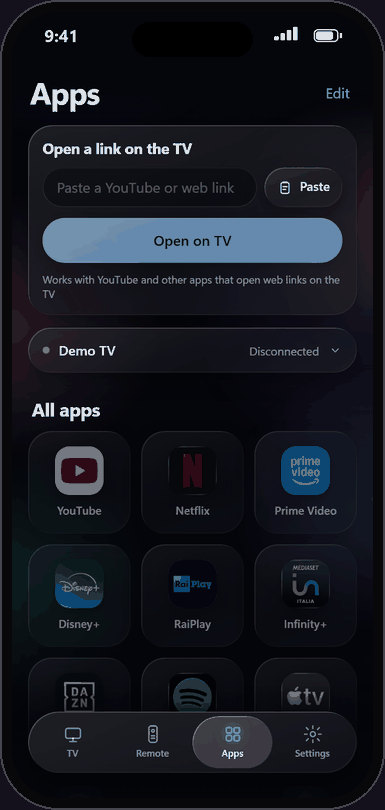

# AppTv: GlassRemoteTv for your Android TV

**A free, ad-free remote control for your own Android TV / Google TV. It runs on the TV itself, so you do not need a computer.**

[Italiano](README.it.md) · [Install guide](guide/01-install-on-your-tv.md) · [Security](guide/02-security.md) · [Troubleshooting](guide/03-troubleshooting.md) · [Build from source](guide/04-build-from-source.md) · [Health and maintenance](guide/05-health-and-maintenance.md) · [Tested TVs](guide/06-tested-tvs.md)

  

<p align="center"></p>

---

## What it is

GlassRemoteTv is a small Android app that you install on **your own** Android TV or Google TV. It does two things:

1. It serves the **GlassRemote** phone app (iPhone and Android, Liquid Glass design) on your home network.
2. It presses the TV remote keys for you, through ADB on the TV's own loopback address. The TV talks to itself.

That is why you do not need a computer, a hub or a second device to keep running.

## Why

- No ads.
- No account.
- No tracking. No data leaves your home network: there is no server and no analytics.
- No computer to leave switched on.
- Plain Java, no libraries. The whole source is in this repository, in [tv-app/](../tv-app/).

## What's new in 0.5.0

TV app 0.5.0 (versionCode 6) with web app 0.8.1.

- **Much faster keys.** A small helper inside the same APK (no network socket) injects the keys: about 10 ms instead of about 1000 ms per key on the test TV. If it cannot start, the app silently falls back to the old method.
- **TV health screen** (Settings > TV health): CPU, memory, a plain-language verdict and a sortable Processes list. Tap the CPU or Memory card to see which apps use it.
- **Clean cache button:** frees the apps' temporary files, never data or logins.
- **Automatic restart (optional, off by default):** daily, weekly or monthly, and only when the TV is in standby.
- **Snappier animations** in the web app.
- **Open a link on the TV:** a new card on the Apps screen. Paste a YouTube or other web link, tap *Open on TV*: the TV wakes by itself and opens it in the app that handles it. Only http/https links are accepted, and the card appears only with the TV app (it is not a cast of photos or videos from the phone).
- **Safer "open a link or app on the TV":** only http/https links and valid app package names.
- A security review of the new code was done and its findings fixed before release, see [SECURITY-AUDIT.md](../SECURITY-AUDIT.md).

How to use the new screen, the cache button and the automatic restart: [guide/05-health-and-maintenance.md](guide/05-health-and-maintenance.md). The health screen, the cache button and the restart exist only in the TV app, not in the computer receiver.

## Install in 5 minutes

You need an Android TV / Google TV and an iPhone or Android phone, both on the same home Wi-Fi.

1. **Download** `GlassRemoteTv-0.5.0.apk` from the [Releases page](https://github.com/MarcoCall96/GlassRemoteTv/releases). The same file is also committed in this repository as [release/GlassRemoteTv-0.5.0.apk](release/GlassRemoteTv-0.5.0.apk), with its [checksum](release/SHA256SUMS.txt). (With the Downloader app nothing is downloaded now: the TV fetches the file itself in step 2.)
2. **Install it on the TV.** Easiest way: the *Downloader* app on the TV and the direct link to the APK. Other ways (USB stick, adb) are in the [install guide](guide/01-install-on-your-tv.md).
3. **Turn on network debugging** on the TV: Settings > Device Preferences > About > tap *Build* seven times > back > Developer options, then *USB debugging* and *Network debugging*.
4. **Open GlassRemoteTv** from the TV apps. When the TV asks *Allow USB debugging?*, tick *Always allow from this computer*, then press *Allow*. You do this once. Keep the app open on the TV: the 6-digit PIN is shown there.
5. **Scan the QR code** on the TV screen with your phone camera (on iPhone, tap the yellow banner/link the Camera shows at the top). The app opens and signs in by itself. If you type the address by hand, type the PIN shown on the TV once.
6. **Add it to the Home Screen.** iPhone: Safari, Share, *Add to Home Screen* (type the PIN once more in the installed app). Android: Chrome menu, *Install app*.

If the layout looks too short the very first time on iPhone, close the app from the app switcher and open it again.

By default the TV remembers up to 30 phones and keeps up to 24 connections at once, which is plenty for a household. To change these limits, see [Limits you can change](guide/04-build-from-source.md#limits-you-can-change).

Optional: you can also put the app in the favorites row of the TV Home screen, see [guide/01-install-on-your-tv.md](guide/01-install-on-your-tv.md#put-the-app-on-your-tv-home-screen-optional).

Full steps with checks after each one: [guide/01-install-on-your-tv.md](guide/01-install-on-your-tv.md).

## Security in short

Please read [guide/02-security.md](guide/02-security.md) once. The short version:

- **Network debugging must be ON.** It is the only way a normal app can press the remote keys. With it on, any computer on your Wi-Fi that you approve on the TV screen gets deep (shell-level) control of the TV. Do not approve prompts you do not recognize.
- **A PIN and a random port protect the app.** Each installation picks its own port. Each phone signs in once with the PIN and keeps a long random token. 5 wrong tries lock that address for a minute (longer each round, up to 15 minutes).
- **Only your home network can connect.** Devices with public addresses are refused.
- **The traffic is plain HTTP, not encrypted.** Do not use it on Wi-Fi you do not trust. A guest can use the TV only if they can see the PIN or the QR code on the TV screen.
- **Never forward a port on your router.**
- **You can switch it off any time:** turn off Network debugging and USB debugging. The remote then stops working until you turn them on again.

## Which TVs work

Android TV and Google TV. **Tested on Android 10 only**: see [Tested TVs](guide/06-tested-tvs.md), which also explains what to expect on other versions (the TV must offer *Network debugging*; Android 11 and newer are untested and many offer only *Wireless debugging*, which this app does not support). Not supported: Samsung (Tizen), LG (webOS), Roku, Fire TV, Apple TV. Tried it on your TV? [Report it](https://github.com/MarcoCall96/GlassRemoteTv/issues/new?template=tv-report.yml).

The app speaks Italiano, English, Español, Français, Deutsch and Português.

## Verify your download

The APK is signed with the maintainer's key (certificate subject `CN=GlassRemoteTv`). Check the checksum against [release/SHA256SUMS.txt](release/SHA256SUMS.txt):

```powershell
Get-FileHash -Algorithm SHA256 GlassRemoteTv-0.5.0.apk
```

```bash
shasum -a 256 GlassRemoteTv-0.5.0.apk
```

Expected SHA-256 of the 0.5.0 APK:

```
b005fe45eabd5b5a2a94b85c512989cb805b4f543846b80919cf6e2325d75731
```

If you have the Android build-tools, you can also check the signature:

```
apksigner verify --print-certs GlassRemoteTv-0.5.0.apk
```

The SHA-256 of the signing certificate must be:

```
62:38:B1:A8:AB:67:23:29:2A:25:60:C9:23:48:8C:82:05:B6:98:1E:61:5F:77:4C:2B:65:44:92:DF:6D:57:07
```

If you build the app yourself, your APK is signed with your own key, so the fingerprint is different. See [guide/04-build-from-source.md](guide/04-build-from-source.md).

## What is in this repository

GlassRemoteTv is one repository. This `AppTv/` folder holds the ready-to-install TV release and its guides. The rest of the repository holds the phone web app (`docs/`), the optional computer receiver (`receiver/`) and the TV app sources (`tv-app/`).

| Folder or file | What it holds |
|---|---|
| [release/](release/) | The signed APK and `SHA256SUMS.txt` |
| [guide/](guide/01-install-on-your-tv.md) | Step-by-step guides (English), including [health and maintenance](guide/05-health-and-maintenance.md), and `guide/it/` (Italiano) |
| `CLAUDE.md`, `AGENTS.md` | Instructions for an AI coding assistant that helps you install it |
| [../tv-app/](../tv-app/) | The Java app, its build script and tests. It bundles the phone web app from `docs/` into the APK |
| [../docs/](../docs/) | The phone web app (source of truth) and its demo |
| [../receiver/](../receiver/) | The optional computer receiver |
| [../SECURITY-AUDIT.md](../SECURITY-AUDIT.md) | Summary of the security audit and what was fixed |

## Let an AI assistant help

Open the `AppTv/` folder with an AI coding assistant (Claude, Copilot, Codex) and say: **"Help me install GlassRemoteTv on my TV."** It follows [CLAUDE.md](CLAUDE.md), asks a few questions and guides you step by step, in your language. You always do the steps on the TV yourself.

## Contributing and reporting problems

Bug reports and pull requests are welcome. To report a security problem, open a **private security advisory** on GitHub (*Security*, *Report a vulnerability*), not a public issue. Before posting logs or screenshots, remove IP addresses and any personal data.

## Credits and trademarks

Built with plain Java and the Android SDK command line tools. The web app uses brand logos from Simple Icons. All product names, logos and app icons are trademarks of their respective owners and are used only to identify the apps on your TV. This project is not affiliated with or endorsed by any TV or streaming brand.

## License

[MIT](../LICENSE)
