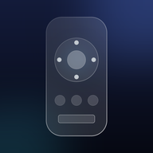
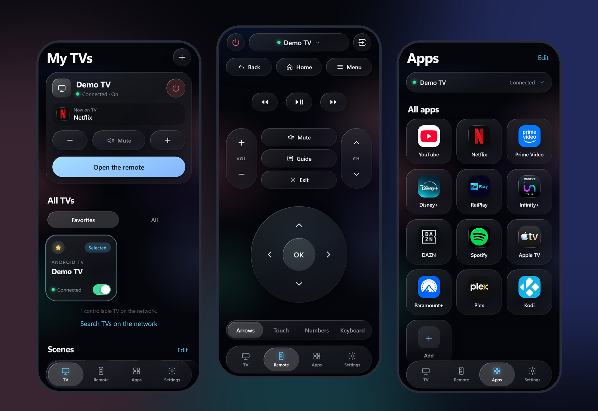

<div align="center">



# GlassRemote

**Il telecomando per la tua Android TV: gratis, senza pubblicità, senza account.**
**Niente limiti, niente blocchi, niente tracciamento.**

[Demo online](https://marcocall96.github.io/GlassRemoteTv/) · [Installa su iPhone / Android](guide/it/01-installare-sul-telefono.md) · [English](README.md)

</div>

<p align="center"></p>

---

## Perché

Le app telecomando sono piene di pubblicità, limitazioni e si bloccano sul più bello.
GlassRemote è una web app (PWA) piccola, veloce e open source, in stile **Liquid Glass**, pensata per iPhone 16 Pro e perfetta anche su Android.

- Nessuna pubblicità, nessun account, nessuna analisi dei dati
- Si installa come una vera app (Aggiungi a Home), senza App Store
- Solo HTML, CSS e JavaScript, nessuna libreria esterna

## Funzioni

Frecce, touchpad, tastierino numerico, tastiera con dettatura e incolla, app con icone ufficiali, **scene** (app + volume + timer in un tocco), **timer di spegnimento**, più TV con preferite, ricerca automatica delle TV, **Siri e Comandi Rapidi**, modalità a una mano, interfaccia che si apre anche senza connessione, **6 lingue** (Italiano, English, Español, Français, Deutsch, Português) da scegliere in Impostazioni.

## Come funziona (onestamente)

Una pagina web non può parlare direttamente con la TV. Servono due parti:

```
 [ Telefono: app ]  --Wi-Fi-->  [ Ricevitore ]  --Android TV Remote v2-->  [ TV ]
   docs/ (PWA)                  receiver/ (Python)                          porte 6466 / 6467
```

1. **L'app** (`docs/`): l'interfaccia. Su GitHub Pages funziona solo come **dimostrazione**, con una TV di prova.
2. **Il ricevitore** (`receiver/`): un piccolo programma Python che gira su un computer di casa, parla con la TV e passa l'app al telefono.

> La demo online non comanda nessuna TV. Per comandarla apri l'app **dal ricevitore**: `http://<IP-del-computer>:8780`.
> **In arrivo:** un'app Android per la TV stessa, così non serve più nessun computer ([roadmap](guide/it/06-app-android-tv-roadmap.md)).

## Avvio rapido (5 minuti)

Servono: un computer sul tuo Wi-Fi di casa con [Python 3.10+](https://www.python.org/downloads/) e una **Android TV / Google TV** sulla stessa rete.

```bash
git clone https://github.com/MarcoCall96/GlassRemoteTv.git
cd GlassRemoteTv/receiver
python -m venv venv
# Windows:  venv\Scripts\activate        macOS / Linux:  source venv/bin/activate
pip install -r requirements.txt
python bridge.py --lan
```

1. Il programma stampa un indirizzo tipo `http://192.168.x.x:8780/`. Aprilo dal telefono (stesso Wi-Fi).
2. **iPhone:** Safari, Condividi, **Aggiungi alla schermata Home**. **Android:** Chrome, menu, **Installa app / Aggiungi a schermata Home**.
3. Nell'app tocca **+** oppure **Cerca TV sulla rete**, scegli la TV.
4. Sulla TV compare un **codice di 6 caratteri**: scrivilo nell'app (**Abbina**). Si fa una volta sola.

Guide: [installazione sul telefono](guide/it/01-installare-sul-telefono.md) · [ricevitore](guide/it/02-avviare-il-ricevitore.md) · [problemi comuni](guide/it/04-problemi-comuni.md)

## Quali TV funzionano?

Tutte le TV con **Android TV o Google TV** (Sony, Philips, TCL, Hisense, Xiaomi, Panasonic, Sharp, Nvidia Shield, Chromecast con Google TV...).
Samsung (Tizen), LG (webOS), Roku e Fire TV **non sono ancora supportate**. Elenco completo: [guide/it/03-tv-compatibili.md](guide/it/03-tv-compatibili.md).

## Fatti aiutare da un assistente AI

Nel repository ci sono [`CLAUDE.it.md`](CLAUDE.it.md) (e la versione inglese [`CLAUDE.md`](CLAUDE.md)) più [`AGENTS.md`](AGENTS.md): istruzioni complete per un assistente AI (Claude, Copilot, Codex...).
Apri la cartella con il tuo assistente e scrivi: **"Configura GlassRemote per me."** Ti guida passo passo nella tua lingua.

## Sicurezza

Tutto resta nella tua rete di casa. Il ricevitore risponde solo a dispositivi della rete locale. **Non aprire mai porte sul router.** Chiave e certificato di abbinamento restano in `receiver/bridge-data/` (escluso da git). Dettagli: [guide/it/07-sicurezza.md](guide/it/07-sicurezza.md).

## Contribuire

Aiuto benvenuto su: app Android per la TV, supporto Samsung / LG / Roku / Fire TV, traduzioni, prove su altre TV. Vedi [CONTRIBUTING.it.md](CONTRIBUTING.it.md). Se ti è utile, **metti una stella**.

## Marchi

Nomi, loghi e icone delle app sono marchi dei rispettivi proprietari, usati solo per riconoscere le app sulla TV. Il progetto non è affiliato a nessun marchio di TV o streaming.

## Licenza

[MIT](LICENSE)
