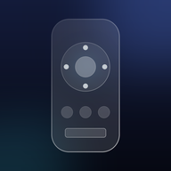
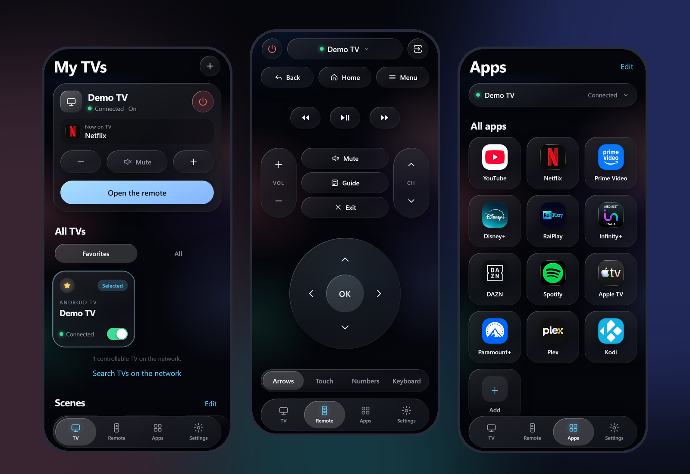

<div align="center">



# GlassRemote

**A free, ad-free, glassy remote control for your Android TV.**
**No ads. No account. No tracking. No limits. It never freezes on you.**

[Try the live demo](https://marcocall96.github.io/GlassRemoteTv/) · [Install on iPhone / Android](guide/01-install-on-your-phone.md) · [Italiano](README.it.md)

   

</div>

<p align="center"></p>

---

## Why this exists

Most TV remote apps are full of ads, locked behind subscriptions, limited to a few buttons, and crash at the worst moment.
GlassRemote is a small, fast, open-source web app that does one thing: **control your TV**.

- **Liquid Glass design** made for the iPhone 16 Pro, and it looks great on Android too
- **Zero ads, zero accounts, zero analytics.** Everything stays on your home network
- **Installs like a real app** (PWA): add it to your home screen, no App Store needed
- **Pure HTML, CSS and JavaScript.** No framework, no build step, no external libraries

## Features

| | |
|---|---|
| Navigation | D-pad, touch pad, number pad, home, back, menu |
| Keyboard | Full QWERTY, voice dictation, paste |
| Apps | Official app icons, recent apps, edit mode, one tap to launch |
| Scenes | "Cinema", "Night" and your own: app + volume + sleep timer in one tap |
| Sleep timer | Turn the TV off after 15, 30, 60 minutes or more |
| Many TVs | Favorites, quick TV switcher, automatic TV discovery |
| Siri / Shortcuts | Control the TV by voice through iOS Shortcuts |
| One-handed mode | Reachable layout for big phones |
| Languages | Italiano, English, Español, Français, Deutsch, Português. Automatic or chosen in Settings |
| Offline | The interface opens even with no connection |

## How it works (the honest version)

A web page cannot talk directly to a TV: browsers cannot open raw TCP sockets, and an HTTPS page cannot call a device on your home network.
So GlassRemote needs a small **receiver** that sits between the phone and the TV. You can run it in two ways:

```
 A) On the TV itself (no computer)
 [ Phone: the app ]  --Wi-Fi-->  [ GlassRemoteTv, installed on the TV ]  --local ADB-->  [ the same TV ]
     docs/ (PWA)                  tv-app/ (Android, plain Java)

 B) On a computer
 [ Phone: the app ]  --Wi-Fi-->  [ Receiver ]  --Android TV Remote v2-->  [ Your TV ]
     docs/ (PWA)                  receiver/ (Python)                       ports 6466 / 6467
```

1. **The app** (`docs/`): the interface you see. It also runs as a **demo** on GitHub Pages, with a fake TV.
2. **GlassRemoteTv** (`tv-app/`): an Android app you install on the TV. It serves the interface to your phone and sends the key presses to the TV. It shows a **QR code** on the TV screen: scan it and the app opens on your phone.
3. **The receiver** (`receiver/`): the alternative, a tiny Python program for a computer in your home.

> The live demo on GitHub Pages is just a preview: it cannot control a real TV.
> To control your TV, open the app **from your TV** (`http://<tv-ip>:<port>`, or scan the QR code on the TV screen) or from your receiver.

## Quick start with the TV app (5 minutes, no computer)

**You need:** an Android TV / Google TV on your home Wi-Fi and an iPhone or Android phone on the same Wi-Fi.

> The ready-to-install release lives in the [`AppTv/`](AppTv/README.md) folder of this repository: the signed APK (`AppTv/release/`), its checksum, step-by-step install guides and instructions for an AI assistant. The rest of the repository holds the web app, the demo, the computer receiver and the TV app sources.

1. Download **GlassRemoteTv-x.y.z.apk** from the [Releases](https://github.com/MarcoCall96/GlassRemoteTv/releases) page (the same file and its `SHA256SUMS.txt` are in [AppTv/release/](AppTv/release/)) and install it on the TV (for example with the *Downloader* app, or `adb install`). Step by step: [AppTv/guide/01-install-on-your-tv.md](AppTv/guide/01-install-on-your-tv.md).
2. On the TV turn on **network debugging**: Settings > Device Preferences > About > tap **Build** seven times > back > Developer options (full steps in the guide of step 1). Open **GlassRemoteTv** from the TV apps. When the TV asks *Allow USB debugging?*, tick **Always allow from this computer**, then press **Allow**.
3. The TV shows a **QR code** and a **PIN**. Scan the code with your phone camera: the app opens and unlocks by itself.
4. **iPhone:** Safari, Share, *Add to Home Screen* (type the PIN once more in the installed app). **Android:** Chrome menu, *Install app*.

> Why network debugging? It is the only way a normal app can press the remote keys on an Android TV (the official remote service refuses requests that come from the TV itself). The PIN keeps other people on your Wi-Fi from using it. Read [guide/07-security.md](guide/07-security.md) first.

## Quick start with a computer receiver (alternative)

**You need:** a computer on your home Wi-Fi (Windows, macOS or Linux) with [Python 3.10+](https://www.python.org/downloads/), and an Android TV / Google TV on the same network.

```bash
git clone https://github.com/MarcoCall96/GlassRemoteTv.git
cd GlassRemoteTv/receiver
python -m venv venv
# Windows:  venv\Scripts\activate        macOS / Linux:  source venv/bin/activate
pip install -r requirements.txt
python bridge.py --lan
```

The receiver prints an address like `http://192.168.x.x:<port>/` (each installation uses its own random port).

1. On your phone (same Wi-Fi) open that address. **iPhone:** Safari, then Share, then *Add to Home Screen*. **Android:** Chrome, then menu, then *Add to Home screen / Install app*.
2. In the app tap **+** or **Search TVs on the network** and choose your TV.
3. The TV shows a **6-character code**. Type it in the app (**Pair**). Done, you only pair once.

> The app speaks **6 languages** (Italiano, English, Español, Français, Deutsch, Português). It follows your phone by default; change it in **Settings, Language**.

Need more help? [Step-by-step guide](guide/01-install-on-your-phone.md) · [Receiver guide](guide/02-run-the-receiver.md) · [Troubleshooting](guide/04-troubleshooting.md)

## Which TVs work?

Any TV that runs **Android TV or Google TV** (Sony, Philips, TCL, Hisense, Xiaomi, Panasonic, Sharp, Nvidia Shield, Chromecast with Google TV and more).
Samsung (Tizen), LG (webOS), Roku and Fire TV are **not supported yet**. Full list: [guide/03-compatible-tvs.md](guide/03-compatible-tvs.md).

## Let an AI assistant do the setup for you

This repo ships with [`CLAUDE.md`](CLAUDE.md) and [`AGENTS.md`](AGENTS.md): complete instructions for an AI coding assistant (Claude, Copilot, Codex...).
Open the repo with your assistant and say: **"Set up GlassRemote for me."** It will walk you through every step, in your language.

## Privacy and security

- No data leaves your home network. There is no server, no analytics, no account.
- The TV app and the receiver only answer to devices on your **local network** and refuse everything else.
- The TV app asks for a **PIN** (shown on the TV) once per phone. Without it nobody can control the TV.
- **Never open ports on your router for it.** Never expose it to the internet.
- The TV app needs network debugging on. You can turn it off at any time, and *Revoke USB debugging authorizations* removes every trusted device.
- Your pairing key and certificate stay in `receiver/bridge-data/`, which is git-ignored.

More in [guide/07-security.md](guide/07-security.md).

## Contributing

Ideas, bug reports and pull requests are very welcome, especially for:

- the **TV app**: more TV brands, a nicer first-run screen, wake from standby
- support for **Samsung, LG, Roku, Fire TV**
- new **languages** and better translations
- testing on more TVs and phones

See [CONTRIBUTING.md](CONTRIBUTING.md). If GlassRemote saves you from one more ad, **give it a star** so others can find it.

## Credits and trademarks

Built on [androidtvremote2](https://github.com/tronikos/androidtvremote2) (Apache-2.0), [aiohttp](https://github.com/aio-libs/aiohttp) and [segno](https://github.com/heuer/segno). Brand logos come from [Simple Icons](https://simpleicons.org/).
All product names, logos and app icons are trademarks of their respective owners and are used only to identify the apps on your TV. This project is not affiliated with or endorsed by any TV or streaming brand.

## License

[MIT](LICENSE)
